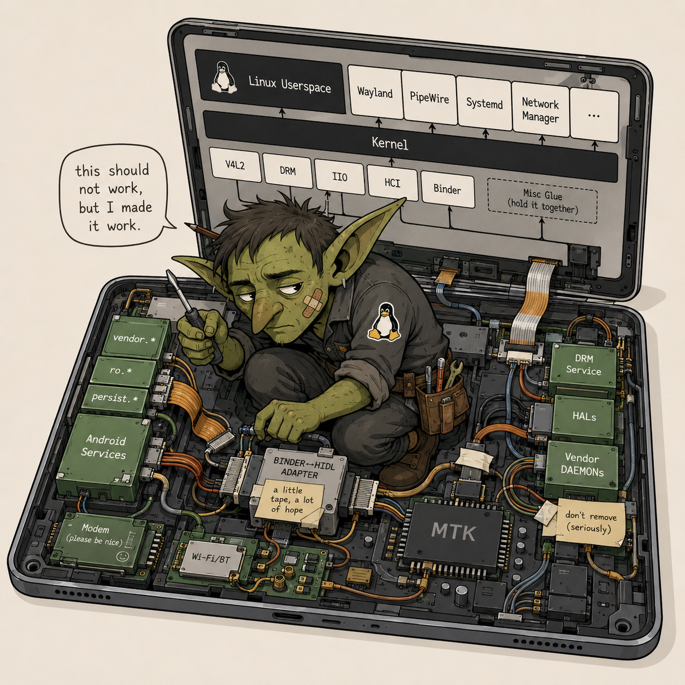
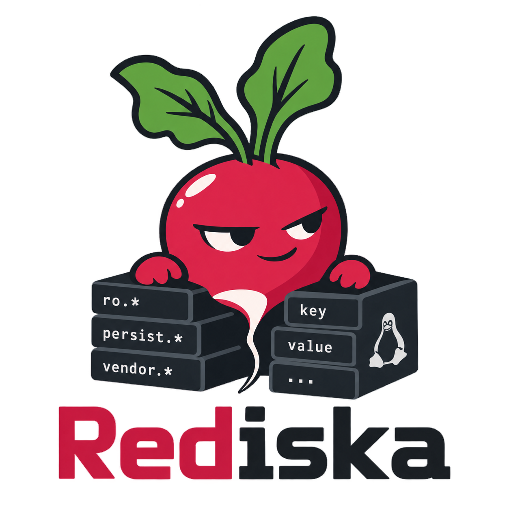

# NevedomaZverushka lore

> [!NOTE]
> This file is non-normative.
> Nothing in here is required to build, boot, operate, debug, or understand the machine.
> If lore disagrees with the technical documentation, the technical documentation wins.
> Facts should remain true even when the wording is unserious.

## Неведома зверушка

The name comes from Pushkin's *The Tale of Tsar Saltan*:

> Родила царица в ночь  
> Не то сына, не то дочь,  
> Не мышонка, не лягушку,  
> А неведому зверушку.

Roughly:

> The tsarina gave birth that night —  
> neither quite a son nor a daughter,  
> neither a little mouse nor a frog,  
> but some unknown little creature.

`nevedoma-zverushka` was already the tablet's hostname before it became the project name.

At some point the name stopped being a joke and became a technically accurate description.

It is not really an Android tablet anymore.
It is not a conventional mainline-Linux tablet either.
It boots native Ubuntu, systemd, KDE, KWin, Panfrost and normal Linux userspace, while a carefully selected pile of MediaTek and Android machinery continues doing the jobs for which nobody sane volunteered to rewrite the drivers.

Ни мышонок, ни лягушка.

Close enough.

---

## tux-with-boobs.png


The original idea was simple:

Linux did not kill Android.

Linux married the useful parts.

Then the generator gave Tux boobs.

There was a brief opportunity to pretend this had not happened.

Instead the file became:

```text
tux-with-boobs.png
````

This is now canonical.

The metaphor remains disturbingly accurate.

Linux is on top.
Android/vendor machinery is underneath.
Both parties have signed an extremely questionable technical prenup.

---

## Before marriage counselling


This was the earlier and considerably less diplomatic interpretation of “Linux on top of Android”.

It made the architecture immediately understandable.

It was also completely unusable as a respectable project identity.

Historically valid.

Aesthetically radioactive.

The wedding image says essentially the same thing, except it can be shown to people without first checking whether HR is nearby.

---

## The mechanic



This one may be the most honest mascot of the engineering process.

Somewhere inside the machine, some poor bastard has to keep Binder, DRM, V4L2, IIO, HCI, vendor daemons, Linux userspace and MediaTek hardware on speaking terms.


That one understands the project.

“MediaTek goblins” subsequently became a useful technical category for anything that behaves exactly as documented nowhere.

---

## The pigsty

The original workspace was:

```text
/Users/felix/tb330fu
```

Calling it a repository would have been charitable.

It contained working source, dead source, stock images, dumps, captures, reports, half-finished experiments, donor trees, binaries, temporary scripts, generated garbage, useful garbage and garbage whose usefulness could no longer be determined without another archaeology expedition.

Names used for it included:

* the pigsty;
* the Augean stables;
* the archaeological site.

Then `/Users/felix/tb330fu-release` happened.

The important rule was that promotion did **not** mean copying the pigsty into Git and congratulating ourselves.

Things had to justify their continued existence.

One casualty was the custom status screen.
It had once been useful.
Later it got into a fight with Plymouth.

Plymouth won.

The status screen stayed in the archaeological layer where defeated software belongs.

---

## Habsburg DRM

At one point we crossbred Samsung MT6768-family DRM source with Lenovo's tablet.

This involved enough ABI translation, structure surgery and vendor-family resemblance that “Habsburg-style DRM crossbreeding” became the obvious name.

The resulting mutant actually drove the panel.

It also required a 180-degree OVL rotation quirk because apparently the family tree was not complicated enough.

A wakelock fix worked too.

Suspend did not.

The donor DRM could light the panel, drive it correctly and perform several feats against nature, but it would not blank the damn thing properly during suspend.

So the experiment was reverted and stock MediaTek DRM remains in production.

The code did not survive.

The terminology did.

### The prenup

There was also a DRM prenup.

No further explanation improves this.

### run72

`run72`.

Those who know, know.

Those who do not know are not helped by inventing an explanation now.

---

## Pig with green lipstick

“Pig with green lipstick” belongs to the charger daemon.

Specifically the charger daemon.

Not the whole architecture.
Not every vendor compatibility layer.
The charger.

Underneath was still an ugly collection of hardware realities inherited from a phone/tablet BSP.

The job was not to make them philosophically pure.

The job was to put something acceptable on the screen while the machine was charging before normal Linux boot.

A pig with green lipstick was sufficient.

It booted.

---

## The day it appeared in `dmesg`

One of the disproportionately satisfying milestones was not graphics, camera or Bluetooth.

It was this general class of event appearing on another Linux machine:

```text
new USB device
...
CDC NCM
...
usb0
```

For the first time the tablet was sitting there presenting itself as an ordinary Linux USB network gadget.

No ADB.
No Android USB framework.
No ritual incantation involving `setprop sys.usb.config`.

Just configfs, NCM and a network interface.

That was one of the moments where the project stopped feeling like “Linux being smuggled through an Android tablet” and started feeling like a Linux machine which happened to have extremely suspicious ancestry.

Later someone could reasonably ask:

> but what if I want ADB?

Sure.

Boot Android under gZVM and give the USB controller to the VM.

You may have your ADB.

Inside Android.

Where it fucking belongs.

---

## If Android does not have systemd

Zram used to be partly owned by Android-init-derived policy and partly by a native helper.

This offended the emerging constitutional order.

Zram is swap policy.

We have systemd.

The final argument was approximately:

> if Android doesn't have systemd, that's Android's problem, not ours

So the Android graph lost zram and a tiny native service got the whole job.

The service uses `zstd`, asks for 2G, enables swap at priority 100 and otherwise minds its own business.

We briefly considered `systemd-zram-generator`.

The kernel has no `devtmpfs`.

Systemd had already demonstrated interesting opinions about whether `/dev/zram0` existed.

A tiny shell script won.

Best code is the code we did not write, unless twelve lines of shell save us from debugging someone else's generic abstraction.

---

## 0444 means “think first”

Both Android-init corpora ended up mode `0444`.

Including the mutable one.

The mutable corpus is still mutable.
You just have to admit what you are doing first:

```text
chmod writable
edit specific files
regenerate manifest
chmod read-only again
```

This paid for itself almost immediately when an automated edit hit the read-only files and stopped instead of casually rewriting the corpus.

The protection is intentionally stupid.

That is why it works.

Manifests, read-only source corpora, deterministic generators, fail-closed compilers and Git are all cheaper than discovering three days later that somebody “cleaned up” a file which was actually evidence.

This applies equally to humans and models.

---

## Mixture of experts my ass

Development eventually acquired an AI architecture of its own.

Roughly:

```text
Sol
    architecture
    task decomposition
    review
    deciding which layer should own what

Luna
    implementation
    migrations
    shell scripts
    repeated debugging
    endless file edits

Git + tests + manifests + permissions
    adult supervision

human
    router
    final authority
```

Or, in the more accurate terminology:

> mixture of experts my ass, implemented via copy-paste

It worked surprisingly well.

The expensive model got used where judgment mattered.
The cheap model kept churning until the boring shit was finished.

No router network required.

---

## “Python would”

At the end of the documentation migration we wanted to remove fixed-column wrapping from the Markdown.

This is, on paper, the kind of task for which using a state-of-the-art language model is deeply stupid.

Luna apparently reached the same conclusion.

Instead of manually rewriting nineteen documentation files, it inspected them with `ripgrep`, wrote a Python formatter, protected fences, tables, lists, blockquotes, inline code, links and hard breaks, ran the script, then reviewed the diff.

The rough human translation of this reasoning was:

> nah, I ain't gonna do all that shit, Python would

Which was possibly the most human thing an LLM did during the project.

Different architecture.
Same engineer instinct.

If the repetitive operation has become boring enough, stop doing it and write the tool.

---

## Maintenance manual, not autobiography

The old tree contained enough evidence to write a magnificent chronological history of every mistake ever made.

We deliberately did not.

The canonical documentation describes the machine that exists.

Not:

* what we tried last Tuesday;
* what failed before lunch;
* which hypothesis looked good for forty minutes;
* which Codex run discovered the missing byte;
* who happened to be logged in when the test passed.

The style ended up close to aircraft maintenance documentation without deliberately implementing Simplified Technical English:

* one thing has one name;
* short direct sentences;
* no decorative synonyms;
* exact ownership;
* unknown means unknown;
* procedure followed by expected result;
* no prose whose purpose is to sound clever.

The informal specification was simpler:

> simple enough to understand, zero ambiguity and bullshit

This was partly for future maintainers.

It was partly for people whose second or third language is English.

It was also, increasingly, for models.

A surprisingly large fraction of successful AI-assisted engineering consists of giving the model a document in which it is difficult to misunderstand what the fuck you meant.

---

## Rediska



Android properties needed a real implementation under glibc/Linux while retained Android/vendor userspace continued expecting Android property semantics.

That implementation became Rediska.

The name is a two-layer stupid joke.

First:

```text
Redis
```

Key/value store.

Second:

```text
редиска
```

Radish.

Also, in Russian, a deliberately unserious mild insult for an unpleasant person.

This gave us a low-level compatibility component named after both a database and a vegetable you might call someone when they are being a bit of an asshole.

Naturally it got a mischievous radish logo.

Rediska is one of the few parts of this mess that may eventually leave the tablet entirely and become its own generic project.

Godspeed, little root vegetable.

---

## Best code

A recurring rule throughout the project was:

> the best code is the code we didn't write

That did not mean “avoid engineering”.

It meant that whenever normal Linux could already own something, normal Linux should own it.

BlueZ instead of inventing Bluetooth policy.

ALSA/PipeWire instead of dragging Android audio upward.

IIO instead of teaching applications about an Android sensor HAL.

V4L2 instead of making every camera consumer understand Camera3.

Configfs instead of Android USB policy.

systemd instead of preserving Android init actions for generic Linux jobs.

And when vendor machinery genuinely knew something we did not want to reverse-engineer for the next six months, we kept it and built a boundary around it.

Purity is expensive.

Interfaces are cheaper.

---

## The unknown creature, again

The end result is difficult to categorize cleanly.

It has an Android-derived kernel.

It has MediaTek vendor daemons.

It has Binder services.

It also has systemd PID 1, KDE Plasma, KWin, Panfrost, BlueZ, PipeWire, V4L2, IIO, configfs, native DRM/KMS and a filesystem full of very ordinary Ubuntu packages.

Android itself is not running the machine.

Linux is.

Somewhere underneath, a collection of vendor components quietly continue doing the things for which they were retained.

Tux is wearing the dress.

The goblin is inside the chassis.

The pig has lipstick.

The DRM family tree should probably not reproduce again.

And somehow the fucking thing works.

